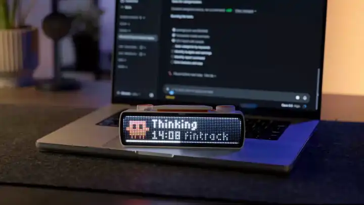

# Claude Code on the BUSY Bar



See all your Claude Code sessions on the BUSY Bar and approve their requests with the bar's buttons.

You need: a BUSY Bar, Claude Code, and a USB cable.

> [!NOTE]
> **What the installer does.** It installs Node.js if you don't have it (from nodejs.org, Homebrew or winget), installs this plugin with Claude Code's own `claude plugin install`, and sets up the bar over the USB cable: puts the app on it and saves this computer's address and a random password in the app's settings. On Windows it also opens port 8790 in the firewall, so the bar can reach your PC.
>
> **What runs afterwards.** A small local server on your computer receives events from Claude Code and shows them on the bar: project folder name, what Claude is doing (`Edit client.ts`), timers, and the command it asks permission for. It answers only your bar, and only with that password.
>
> **What it never does.** It doesn't send anything to the internet, and it doesn't touch your Claude login or API keys. From session logs it takes only the project folder and how full the context is.
>
> Read it first if you like: [install.sh](install.sh), [install.ps1](install.ps1), [the server](plugin/daemon). Or ask Claude Code to review them before you run anything.

## macOS

1. Connect the bar to your Mac with the USB cable.
2. Open Terminal and paste:
   ```
   curl -fsSL https://raw.githubusercontent.com/mrlunev/busybar-claude-code/main/install.sh | bash
   ```
   If it asks for your Mac password, type it and press Return.
3. When the bar shows **Approve? Setup**, press **Start** on the bar.

Done. Unplug the cable and restart Claude Code.

## Windows

1. Connect the bar to your PC with the USB cable.
2. Open PowerShell and paste:
   ```
   irm https://raw.githubusercontent.com/mrlunev/busybar-claude-code/main/install.ps1 | iex
   ```
   When Windows asks to allow changes, click **Yes**.
3. When the bar shows **Approve? Setup**, press **Start** on the bar.

Done. Unplug the cable and restart Claude Code.

## Using it

- The wheel scrolls through your sessions, **Start** opens one, **Back** goes back.
- When Claude asks for permission, the bar blinks. Turn the wheel to pick **Yes** or **No**, then press **Start**.
- Something wrong? The bar says what. Run the same command again to fix most of it.
- Only sessions that run on this computer show up. Cloud sessions and sessions on a remote machine over SSH don't.

## Remove

Run `/plugin uninstall busybar` in Claude Code, then delete the app on the bar in the BUSY app.
