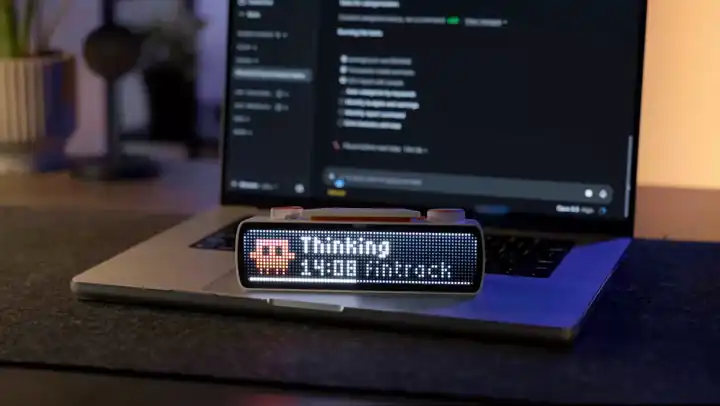

# Claude Code on the BUSY Bar



See all your Claude Code sessions on the BUSY Bar and approve their requests with the bar's buttons.

You need: a BUSY Bar, Claude Code, and a USB cable.

> [!NOTE]
> **What the installer does.** It installs Node.js if you don't have it (from nodejs.org, Homebrew or winget), installs this plugin with Claude Code's own `claude plugin install`, and sets up the bar over the USB cable: puts the app on it and saves this computer's address and a random password in the app's settings. On Windows it also opens port 8790 in the firewall, so the bar can reach your PC.
>
> **What runs afterwards.** A small local server on your computer receives events from Claude Code and serves them to the bar over your local network, as plain unencrypted HTTP. The bar receives: the project folder name; what Claude is doing, as the tool and its target (the start of a Bash command, a search pattern, a file name); timers; permission prompts with the command text; and the questions Claude asks you. Anyone who can read traffic on that network can read this too. The server answers only the bar's addresses recorded at setup, and only with the password. The password is stored in `~/.config/busy-claude-bar` and in the bar app's settings; each setup run makes a new one.
>
> **What it never does.** It doesn't send anything to the internet, and it doesn't touch your Claude login or API keys. From session logs it takes only the project folder and how full the context is.
>
> Read it first if you like: [install.sh](install.sh), [install.ps1](install.ps1), [the server](plugin/daemon). Or ask Claude Code to review them before you run anything.

## macOS

1. Connect the bar to your Mac with the USB cable.
2. Open Terminal and paste:
   ```
   curl -fsSL https://raw.githubusercontent.com/mrlunev/busybar-claude-code/main/install.sh | bash
   ```
   If it asks for your Mac password, type it and press Return.
3. When the bar shows **Approve? Setup**, press **Start** on the bar.

Done. Unplug the cable and restart Claude Code.

## Windows

1. Connect the bar to your PC with the USB cable.
2. Open PowerShell and paste:
   ```
   irm https://raw.githubusercontent.com/mrlunev/busybar-claude-code/main/install.ps1 | iex
   ```
   When Windows asks to allow changes, click **Yes**.
3. When the bar shows **Approve? Setup**, press **Start** on the bar.

Done. Unplug the cable and restart Claude Code.

## How to use

- **Wheel turn**: moves through the sessions; on a permission prompt, picks **Yes** or **No**.
- **Start** or **wheel press**: opens a session; on a prompt, sends the answer.
- **Back**: returns to the list; on a prompt, hands it back to the terminal; from the list, closes the app.

When Claude asks for permission, the bar blinks. If the app isn't running on the bar (the bar is off, or the app was closed), the terminal asks as usual; a prompt waiting on the bar goes back to the terminal about 10 seconds after the bar stops asking for news.

Something wrong? The bar says what. Run the same command again to fix most of it.

Only sessions that run on this computer show up. Cloud sessions and sessions on a remote machine over SSH don't.

## FAQ

Almost everything is fixed the same way: connect the bar with the USB cable and run the install command for your
system again (or `/busybar:setup` in Claude Code). It keeps what already works and fixes the rest.

**The bar says "Wrong token" or "Not paired".** The bar and the computer no longer share the same password, or the
bar calls from an address the computer doesn't know. That happens when setup ran on another computer since, this
computer lost its settings (`~/.config/busy-claude-bar`), or the bar got a new Wi-Fi address from the router. Run
setup again.

**A new computer.** Install on it as above. The bar works with one computer at a time, the last one set up. To go back
to the old computer, run setup there again.

**The bar says "Needs setup".** The app on the bar has no password yet, for example when it was installed from the BUSY
Apps catalog. Its back screen says where to open the bar's web page; there, in Apps → Claude Code Sessions, are the install
commands for Mac and Windows. Run the one for your system with the bar connected by USB.

**The bar says "No computer".** The bar can't reach the computer: it is asleep or off, Claude Code hasn't started since
the computer restarted (the server starts with Claude Code), or the bar and the computer are on different Wi-Fi
networks. Start Claude Code. If the bar still says it, run setup with the cable: it says what is in the way.

**The bar says "Update app".** The plugin was updated and the app on the bar is older. Run setup.

**Still stuck?** [Open an issue](https://github.com/mrlunev/busybar-claude-code/issues) and say what the bar shows.

## Remove

1. In Claude Code, run `/plugin uninstall busybar`, then quit Claude Code: a new session would start the server again.
2. Stop the server and delete its settings and password.

   macOS, in Terminal:
   ```
   curl -X POST http://127.0.0.1:8790/quit
   rm -rf ~/.config/busy-claude-bar
   ```
   Windows, in PowerShell:
   ```
   Invoke-RestMethod -Method Post http://127.0.0.1:8790/quit
   Remove-Item -Recurse -Force "$env:USERPROFILE\.config\busy-claude-bar"
   ```
3. Delete the app on the bar in the BUSY app.

On Windows the firewall rule `ClaudeCodeBusyBar` stays. To delete it, run in PowerShell as administrator:
```
netsh advfirewall firewall delete rule name=ClaudeCodeBusyBar
```

## Source

- [`app/`](app): the app for the bar (TypeScript, built with `busy-cli build`); see its [README](app/README.md).
- [`plugin/`](plugin): the Claude Code plugin with the local server; `plugin/release/` holds the built app that setup puts on the bar.

## License

MIT, see [LICENSE](LICENSE). Claude and Claude Code are trademarks of Anthropic, PBC. This project is not made by or affiliated with Anthropic.